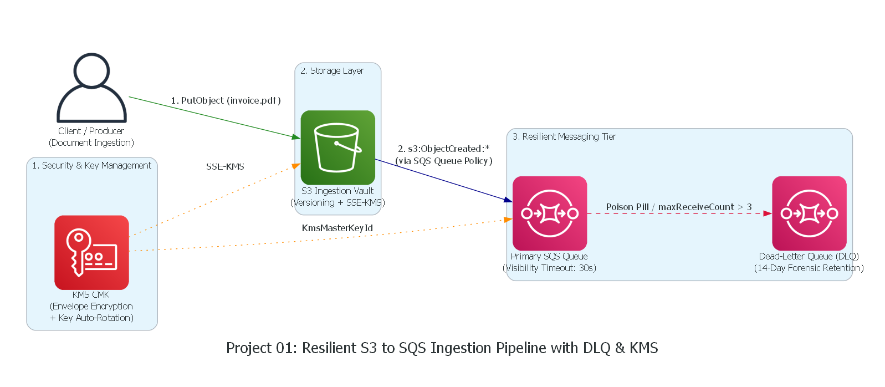
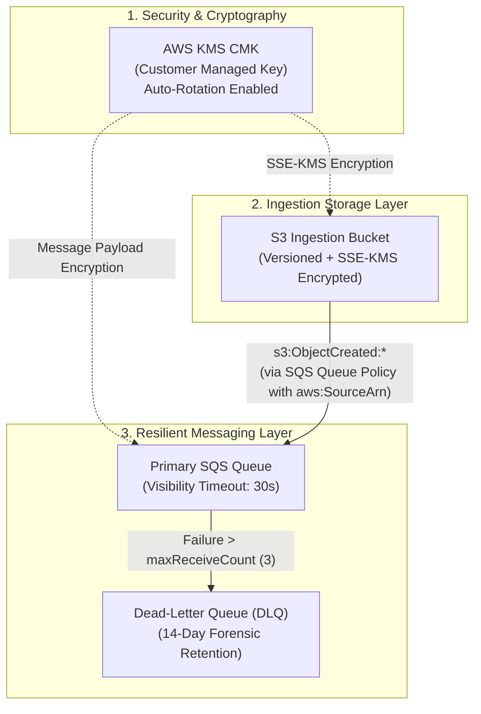

# Project 01: Resilient Event-Driven Ingestion Pipeline (S3 + SQS + DLQ + KMS)

## 1. Architectural Overview
This project provisions a production-grade, decoupled asynchronous ingestion pipeline on AWS using Terraform, simulated locally and verified on **Floci**.





---

## 2. Production "Why" & Architecture Highlights
1. **Decoupled Asynchronous Processing:**
   Prevents bursty traffic (e.g. 10,000 document uploads/min) from directly overwhelming downstream consumer APIs or database connection pools.
2. **Dead-Letter Queue (DLQ) Isolation:**
   Malformed payloads or "poison pill" messages are moved to the DLQ after 3 failed attempts (`maxReceiveCount = 3`), preventing queue head-of-line blocking while keeping audit logs intact.
3. **KMS Envelope Encryption:**
   Enforces Customer Managed Keys (CMKs) with automated yearly key rotation for compliance (PCI-DSS, SOC 2, HIPAA). Master keys never leave KMS Hardware Security Modules.
4. **Least-Privilege Resource Policies:**
   Restricts SQS `SendMessage` permissions strictly to the specific source S3 bucket ARN using the `aws:SourceArn` condition key, preventing Confused Deputy attacks.

---

## 3. Directory Layout
```
01-resilient-s3-sqs-dlq-pipeline/
├── README.md               # Architecture documentation, The Why, and Interview Q&A
├── provider.tf             # Local AWS / Floci provider configuration
├── variables.tf            # Parameterized inputs (environment, retention, maxReceiveCount)
├── main.tf                 # Core infrastructure resources (KMS, S3, SQS, Notification)
├── outputs.tf              # ARNs, endpoints, and queue URLs
└── .gitignore              # Excludes .terraform/ and .tfstate files
```

---

## 4. End-to-End Verification Walkthrough

1. **Initialize and Deploy Infrastructure:**
   ```bash
   terraform init
   terraform apply -auto-approve
   ```

2. **Upload a Test File to S3:**
   ```bash
   aws --endpoint-url=http://localhost:4566 s3 cp test_payload.json s3://sre-ingestion-pipeline-vault-prod/orders/test_payload.json
   ```

3. **Verify SQS Event Received:**
   ```bash
   aws --endpoint-url=http://localhost:4566 sqs receive-message --queue-url http://localhost:4566/000000000000/sre-ingestion-pipeline-queue-prod
   ```
   *Result:* SQS returns the automated `ObjectCreated:Put` event notification.

4. **Floci Web UI Inspection:**
   Open `http://localhost:4500` in your browser:
   - Check **Storage** $\rightarrow$ `sre-ingestion-pipeline-vault-prod` (SSE-KMS + Versioning).
   - Check **SQS** $\rightarrow$ `sre-ingestion-pipeline-queue-prod` and `sre-ingestion-pipeline-dlq-prod`.
   - Check **KMS** $\rightarrow$ `alias/sre-ingestion-pipeline-key`.

---

## 5. SRE / Cloud Architect Interview Deep-Dive Q&A

### Q1: Why use an SQS Dead-Letter Queue (DLQ) instead of just logging consumer errors and retrying indefinitely?
**Answer:** 
Retrying indefinitely causes **Head-of-Line Blocking** and a **Retry Storm**. In standard SQS queues, a message that repeatedly crashes the worker consumes compute cycles and delays all subsequent legitimate messages. Moving bad messages ("poison pills") to a DLQ after `maxReceiveCount = 3` isolates unprocessable data, preserves forensic logs for 14 days, and lets the primary pipeline continue processing at full speed.

### Q2: What is the SQS Visibility Timeout, and what happens if a consumer worker takes longer than 30 seconds to process a batch?
**Answer:** 
When a consumer receives a message, SQS hides it from other consumers for the duration of `visibility_timeout_seconds` (30s). If the worker does not delete the message within 30 seconds (e.g. heavy image processing or database lock), SQS assumes the worker crashed and makes the message visible again. Another worker will pick it up, causing **duplicate processing**. 
*Mitigation:* The consumer should send heartbeat `ChangeMessageVisibility` API calls while still actively working on long jobs.

### Q3: Why is the `aws:SourceArn` condition mandatory in the SQS Queue Policy?
**Answer:** 
Without `aws:SourceArn`, any S3 bucket in any AWS account could be configured to send notifications to your queue (the **Confused Deputy Problem**). By enforcing `"Condition": { "ArnEquals": { "aws:SourceArn": aws_s3_bucket.ingestion_bucket.arn } }`, the queue cryptographically validates that the notification originated strictly from your own bucket.

### Q4: Why did we specify `depends_on = [aws_sqs_queue_policy.allow_s3_ingestion]` on the `aws_s3_bucket_notification` resource?
**Answer:** 
Terraform builds a Directed Acyclic Graph (DAG) based on resource references. S3 bucket notifications reference the SQS Queue ARN, but do *not* implicitly reference the SQS Policy. When S3 creates the notification, AWS sends an immediate permission test probe to the queue. If Terraform creates the notification before the queue policy has finished applying, S3 rejects the request with an `AccessDenied` error. `depends_on` enforces the exact deployment sequence.
