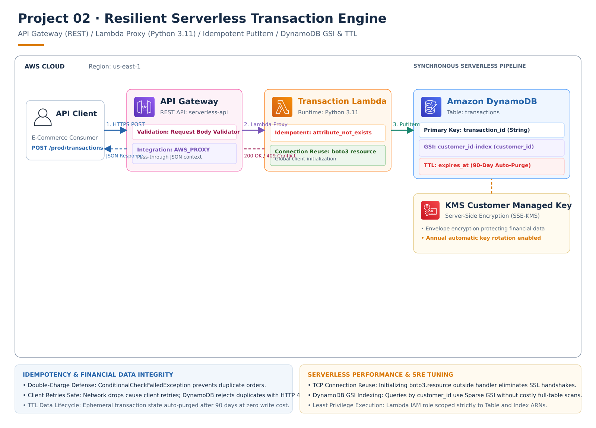
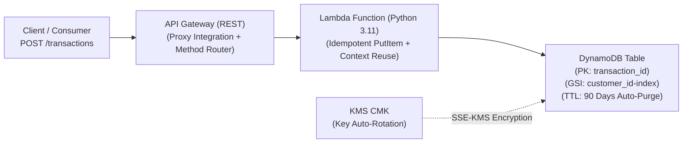

# Project 02: Resilient Serverless Transaction Engine (API Gateway -> Lambda -> DynamoDB)

## 1. Architectural Overview
This project provisions an enterprise-grade, highly resilient Serverless Microservice API on AWS using Terraform, simulated locally and verified on **Floci**.



> **Editable Architecture:** Open [`project-02-architecture.drawio`](./project-02-architecture.drawio) directly in [diagrams.net](https://app.diagrams.net) to edit any element. Re-render with `python render_architecture.py`.



---

## 2. Production "Why" & Architectural Breakdown

In modern cloud engineering, building a transactional payment or order API requires strict guarantees: **zero duplicate charges on network retries**, **low single-digit millisecond latency**, **automatic compliance data expiration**, and **zero-trust encryption**.

Here is how each layer is architected in Terraform:

### Layer 1: Security & Cryptography (KMS CMK)
* **Resource:** `aws_kms_key.dynamo_key` + `aws_kms_alias.dynamo_key_alias`
* **Why:** Rather than relying on the shared AWS default key (`aws/dynamodb`), an enterprise Customer Managed Key (CMK) provides:
  1. Automated annual cryptographic key rotation (`enable_key_rotation = true`).
  2. Scoped IAM Key Policies that strictly whitelist only our Lambda execution role.
  3. Compliance adherence (PCI-DSS for payments, SOC 2, ISO 27001).

### Layer 2: Persistent Storage (DynamoDB Table with GSI & TTL)
* **Resource:** `aws_dynamodb_table.transactions_table`
* **Why:**
  1. **High-Cardinality Partition Key (`transaction_id`):** Distributes read/write I/O evenly across physical storage partitions, avoiding "hot partition" throttling.
  2. **Global Secondary Index (`customer_id-index`):** Enables sub-10ms queries for *"Get all transactions for Customer X"* without triggering an expensive and slow table scan.
  3. **Automated Time-To-Live (`ttl`):** Deletes transactions older than 90 days at **zero cost** (consumes 0 RCU and 0 WCU), preventing runaway storage bloat.
  4. **On-Demand Auto-Scaling (`PAY_PER_REQUEST`):** Seamlessly handles spiky transaction volumes without capacity planning.

### Layer 3: Serverless Compute (Lambda & Execution Role)
* **Resources:** `data.archive_file.lambda_zip`, `aws_iam_role.lambda_exec_role`, `aws_iam_role_policy.lambda_dynamo_policy`, `aws_lambda_function.transaction_processor`
* **Why:**
  1. **Automated Packaging:** Terraform computes the SHA-256 hash of `src/lambda_function.py`, re-zipping and updating Lambda in place only when code changes.
  2. **Idempotency Protection:** Uses DynamoDB's `attribute_not_exists(transaction_id)`. If a client retries a network request with the same transaction ID, DynamoDB rejects it with `ConditionalCheckFailedException`, returning HTTP `409 Conflict` to prevent double-charging.
  3. **Cold Start Mitigation:** Boto3 clients are initialized outside the `lambda_handler` function, reusing established TCP connection pools across warm executions.

### Layer 4: Edge Ingress (The 7 Decoupled API Gateway Blocks)
Unlike monolithic web frameworks, AWS API Gateway breaks an API down into decoupled architectural blocks:
1. `aws_api_gateway_rest_api` — Top-level root container and domain manager.
2. `aws_api_gateway_resource` — URL path segment (`/transactions`).
3. `aws_api_gateway_method` — HTTP verb (`POST`) and authentication checkpoint.
4. `aws_api_gateway_integration` — Connects the HTTP method to Lambda using `type = "AWS_PROXY"` (passes full request payload without manual mapping templates).
5. `aws_api_gateway_deployment` — Immutable snapshot of the API configuration.
6. `aws_api_gateway_stage` — Environment release target (`prod`).
7. `aws_lambda_permission` — Resource-based policy allowing `apigateway.amazonaws.com` to invoke the Lambda function.

---

## 3. Directory Layout
```
02-resilient-serverless-api-dynamodb/
├── README.md               # Architecture documentation, The Why, and walkthrough
├── INTERVIEW_QNA.md        # Dedicated SRE / Cloud Architect interview masterclass
├── architecture_diagram.png# Rendered visual architecture diagram
├── generate_diagram.py     # Python diagrams script
├── provider.tf             # Local AWS / Floci provider configuration
├── variables.tf            # Parameterized inputs (environment, billing mode)
├── outputs.tf              # API endpoint URL, Lambda ARN, DynamoDB table ARN
├── main.tf                 # Core infrastructure resources (KMS, DynamoDB, IAM, Lambda, API Gateway)
├── .gitignore              # Excludes .terraform/ and .tfstate files
└── src/
    └── lambda_function.py  # Python 3.11 Lambda handler with idempotency check
```

---

## 4. SRE Failure Modes & Resilience Defenses

| Failure Mode | Production Impact | Architectural Defense |
| :--- | :--- | :--- |
| **Network Retry / Double Payment** | Client pays twice due to network timeout on initial submission. | **Idempotent Conditional Write:** DynamoDB rejects duplicate keys via `attribute_not_exists(transaction_id)` with HTTP 409. |
| **Runaway Storage Bloat** | Old audit records accumulate, increasing storage costs indefinitely. | **Time-To-Live (TTL):** Internal AWS sweeper purges items older than 90 days at **0 RCU / 0 WCU cost**. |
| **Hot Partition Throttling** | Heavy traffic hits a single partition key, starving other users. | **High-Cardinality Hash Key:** Using UUID `transaction_id` evenly disperses data across partitions. |
| **Cold Start Latency Spikes** | New Lambda containers take hundreds of milliseconds to initialize. | **Execution Context Reuse:** Global client initialization caches TCP/TLS sockets across warm invocations. |
| **Traffic Spikes / DoS** | Massive request burst crashes downstream database. | **Token Bucket Throttling:** API Gateway enforces rate and burst limits, returning HTTP 429 Too Many Requests. |

---

## 5. Verification & Live Testing

1. **Deploy the Complete Stack:**
   ```bash
   terraform init
   terraform apply -auto-approve
   ```

2. **Verify DynamoDB Idempotency via AWS CLI:**
   ```bash
   # First write: Succeeds
   aws --endpoint-url=http://localhost:4566 dynamodb put-item \
     --table-name sre-serverless-engine-transactions-prod \
     --item '{"transaction_id": {"S": "TX-1001"}, "customer_id": {"S": "CUST-402"}, "amount": {"N": "150.00"}}' \
     --condition-expression "attribute_not_exists(transaction_id)"

   # Duplicate write: Rejected with ConditionalCheckFailedException
   aws --endpoint-url=http://localhost:4566 dynamodb put-item \
     --table-name sre-serverless-engine-transactions-prod \
     --item '{"transaction_id": {"S": "TX-1001"}, "customer_id": {"S": "CUST-402"}, "amount": {"N": "150.00"}}' \
     --condition-expression "attribute_not_exists(transaction_id)"
   ```

3. **Floci Web Console Inspection:**
   Open `http://localhost:4500` in your browser:
   * **DynamoDB:** Inspect table `sre-serverless-engine-transactions-prod`, GSI `customer_id-index`, and TTL settings.
   * **KMS:** Inspect CMK alias `alias/sre-serverless-engine-key`.
   * **Serverless:** View Lambda function `sre-serverless-engine-processor-prod` and IAM execution roles.
