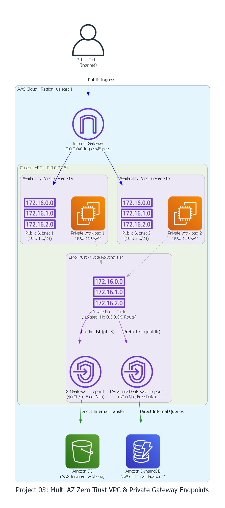

# Project 03: Multi-AZ Zero-Trust VPC & Private Gateway Endpoints

A production-grade, multi-AZ network architecture designed for **Zero-Trust security** and **FinOps cost optimization**. Built with HashiCorp Terraform and validated against **Floci** (Local AWS Emulator).



---

## Architectural Highlights

1. **Multi-AZ High Availability:**
   - Deployed across 2 Availability Zones (`us-east-1a`, `us-east-1b`) for complete zone-failure resilience.
   - Public Subnets (`10.0.1.0/24`, `10.0.2.0/24`) attached to an **Internet Gateway (IGW)** for ingress traffic.
   - Private Subnets (`10.0.11.0/24`, `10.0.12.0/24`) strictly isolated with **no route to the Internet Gateway**.

2. **FinOps & Zero-Trust Superpower: VPC Gateway Endpoints:**
   - **Cost Elimination:** Bypasses costly AWS NAT Gateways ($0.045/hr + $0.045/GB). VPC Gateway Endpoints for **S3** and **DynamoDB** are **100% Free** ($0.00/hr, $0.00/GB).
   - **Zero-Trust Data Protection:** Traffic between private workloads and core AWS storage/database services travels exclusively across the AWS internal network backbone without ever touching the public internet.

---

## Directory Structure

```text
03-multiaz-zerotrust-vpc-endpoints/
├── main.tf                 # VPC, Subnets, Route Tables, IGW, and Gateway Endpoints
├── variables.tf            # CIDR blocks, AZs, and project identifiers
├── outputs.tf              # VPC IDs, Subnet IDs, and Endpoint IDs
├── provider.tf             # AWS Provider configured for Floci (localhost:4566)
├── generate_diagram.py     # Automated Python Graphviz architecture generator
├── architecture_diagram.png# Generated visual architecture diagram
├── INTERVIEW_QNA.md        # 5 First-principles SRE & Cloud Architect interview scenarios
└── README.md               # Documentation and verification guide
```

---

## Step-by-Step Local Verification (Floci)

### 1. Ensure Floci Containers are Running
```powershell
wsl -d podman-machine-default env XDG_RUNTIME_DIR=/run/user/1000 podman start floci floci-ui
```

### 2. Initialize and Apply Terraform
```powershell
terraform init
terraform plan
terraform apply -auto-approve
```

### 3. Verify Resources in Floci

```powershell
# Verify VPCs
aws --endpoint-url=http://localhost:4566 ec2 describe-vpcs

# Verify Subnets
aws --endpoint-url=http://localhost:4566 ec2 describe-subnets

# Verify VPC Gateway Endpoints
aws --endpoint-url=http://localhost:4566 ec2 describe-vpc-endpoints
```

### 4. Inspect via Floci Web UI
Open your browser to:
* **Floci Dashboard:** `http://localhost:4500` -> Navigate to **EC2 / VPC** to inspect the custom VPC, subnets, route tables, and endpoints.

### 5. Generate Architecture Diagram
```powershell
python generate_diagram.py
```

### 6. Clean Up
```powershell
terraform destroy -auto-approve
```

---

## Interview Mastery Guide

For deep-dive scenarios covering FinOps NAT calculations, Route Table Prefix Lists under the hood, and Zero-Trust Endpoint Policies, read:
👉 **[INTERVIEW_QNA.md](./INTERVIEW_QNA.md)**
