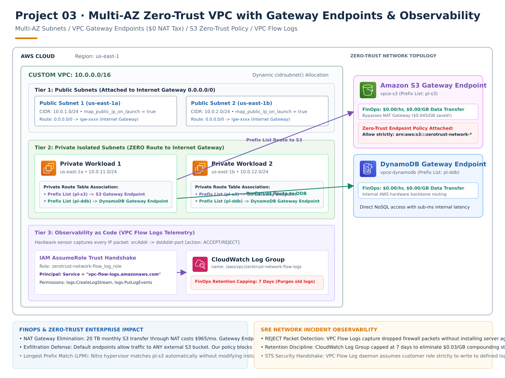

# Project 03: Multi-AZ Zero-Trust VPC with Gateway Endpoints & Observability

A production-grade, multi-AZ network architecture engineered for **Zero-Trust security**, **FinOps cost optimization**, and **real-time network observability**. Built with HashiCorp Terraform and validated against **Floci** (Local AWS Emulator).



> **Editable Architecture:** Open [`project-03-architecture.drawio`](./project-03-architecture.drawio) directly in [diagrams.net](https://app.diagrams.net) to edit any element. Re-render with `python render_architecture.py`.

---

## 1. Executive Summary & Production Problem Statement

In enterprise cloud architectures, network security and data transfer costs are primary failure vectors:
* **The Cost Trap (NAT Gateway Tax):** Routing large S3 transfers or DynamoDB queries through NAT Gateways costs **$0.045/hour + $0.045 per GB**. For an organization syncing 20 TB of data monthly, this equates to **~$965/month** in avoidable egress fees.
* **The Security Blindspot:** Private subnets without network observability leave SREs blind to port scans, unauthorized lateral movements, and failed connection attempts.
* **The Data Exfiltration Vulnerability:** Default VPC Endpoints permit traffic to *any* S3 bucket in the world, enabling compromised containers to exfiltrate proprietary data to attacker-controlled accounts.

This architecture solves all three challenges simultaneously by deploying:
1. **Multi-AZ Network Symmetry** across `us-east-1a` and `us-east-1b`.
2. **VPC Gateway Endpoints for S3 & DynamoDB** providing **$0.00/hour, $0.00/GB** direct routing.
3. **Zero-Trust Endpoint Policies** restricting data movement strictly to company-owned buckets.
4. **Automated VPC Flow Logs** delivering packet-level `ACCEPT`/`REJECT` telemetry to CloudWatch Logs with managed retention.

---

## 2. Service-by-Service Deep-Dive (Under-the-Hood Mechanics)

### A. Custom VPC (`aws_vpc`) & Dynamic Subnet Math
* **Base CIDR:** `10.0.0.0/16` ($2^{16} = 65{,}536$ total IPv4 addresses).
* **DNS Flags:** Both `enable_dns_support = true` and `enable_dns_hostnames = true` are mandatory. Without these, AWS will not resolve public AWS endpoints (e.g., `s3.us-east-1.amazonaws.com`) to internal Gateway Endpoint routes.
* **Dynamic Slicing via `cidrsubnet()`:**
  $$\text{cidrsubnet}(\text{prefix}, \text{newbits}, \text{netnum})$$
  Adding `8` bits turns `/16` into `/24` subnets dynamically. The `netnum` parameter populates the 3rd octet directly:
  - Public Subnets: `cidrsubnet(var.vpc_cidr, 8, count.index + 1)` $\rightarrow$ `10.0.1.0/24`, `10.0.2.0/24`
  - Private Subnets: `cidrsubnet(var.vpc_cidr, 8, count.index + 11)` $\rightarrow$ `10.0.11.0/24`, `10.0.12.0/24`

### B. Public vs. Private Routing Isolation
* **Internet Gateway (`aws_internet_gateway`):** Attached at the VPC edge. Handles horizontally-scaled, highly available NAT translation for public internet traffic.
* **Public Route Table (`aws_route_table.public`):** Explicitly maps `0.0.0.0/0` $\rightarrow$ `igw-xxxx`.
* **Private Route Table (`aws_route_table.private`):** **Zero direct internet routes**. Workloads inside private subnets have no pathway to or from the public internet.

### C. VPC Gateway Endpoints (`aws_vpc_endpoint` for S3 & DynamoDB)
* **Under-the-Hood Routing:** Gateway Endpoints do **not** use Elastic Network Interfaces (ENIs) or consume IP addresses. Instead, AWS injects an AWS-managed **Prefix List** (e.g., `pl-63a5400a` for S3) directly into the private route table.
* **AWS Nitro Interception:** Outbound packets destined for S3 or DynamoDB match the prefix list via Longest Prefix Match (LPM) and are intercepted at the hypervisor layer, traversing the internal AWS backbone at $0 cost.

### D. Zero-Trust S3 Endpoint Policy
* Default endpoint policies allow `*` actions on `*` resources.
* We enforce least privilege by attaching a strict JSON policy allowing only `s3:GetObject`, `s3:PutObject`, and `s3:ListBucket` against company-owned buckets matching `arn:aws:s3:::zerotrust-network-*`. Any attempt to write to an external AWS bucket is dropped with HTTP 403 Forbidden.

### E. Telemetry & Observability: VPC Flow Logs
* **Sensor Engine (`aws_flow_log`):** Monitors every ENI in the VPC and captures network metadata:
  $$\text{srcaddr} \rightarrow \text{dstaddr} \ : \ \text{dstport} \ [ \text{protocol} ] \ \longrightarrow \ \mathbf{ACCEPT} \ / \ \mathbf{REJECT}$$
* **IAM Trust (`aws_iam_role`):** Trusts the AWS daemon `vpc-flow-logs.amazonaws.com` via `sts:AssumeRole`.
* **Log Retention (`aws_cloudwatch_log_group`):** Capped at **7 days** to prevent unbounded storage costs while providing real-time visibility for SRE incident response.

---

## 3. How This Code Compares: Local Floci vs. Real-World Production

| Architectural Component | Local Floci Simulation | Real-World AWS Production | Verdict |
| :--- | :--- | :--- | :---: |
| **Terraform HCL Code** | 100% standard AWS provider HCL | Identical HCL deployed to AWS accounts | **Identical** |
| **Route Table Associations** | Managed route tables and prefix list simulation | Route table LPM routing via AWS Route Tables | **Identical** |
| **IAM Policy & JSON Encoding** | Standard IAM assume role and policy structures | Enforced by AWS IAM security control planes | **Identical** |
| **VPC Flow Log Data Model** | Simulated ENI capture to local CloudWatch log group | Hardware-level packet capture via AWS Nitro System | **Near-Identical** |
| **Underlying Hardware Fabric** | Docker container network bridge in WSL2/Podman | Multi-AZ physical data centers linked by 100GbE fiber | **Different** |
| **Prefix List Synchronization** | Static local service route mapping | AWS automatically updates regional IP CIDR ranges | **Automated in Prod** |

---

## 4. Production Hardening: "What More Can We Do?" (Enterprise Roadmap)

For ultra-high-scale, enterprise-grade production environments, this architecture can be extended with:

1. **3-Tier Subnet Architecture:**
   - Add a dedicated **Tier 3 (Database Subnets)** with `/28` CIDRs strictly for RDS Aurora PostgreSQL and ElastiCache Redis, with no VPC endpoints attached.
2. **Security Group Chaining:**
   - Implement stateful Security Groups where the App tier only accepts ingress on port 8080 if the source is the ALB's Security Group ID (`sg-xxxx`), eliminating IP-based firewall rules.
3. **Automated Incident Alarms on `REJECT` Spikes:**
   - Create a CloudWatch Metric Filter on `/aws/vpc/zerotrust-network-flow-logs` matching `[..., action="REJECT"]` and wire a CloudWatch Alarm to trigger PagerDuty/SNS when rejected packets exceed 100/minute.
4. **S3 Flow Log Export for Long-Term Auditing:**
   - In addition to CloudWatch, stream Flow Logs into an S3 bucket partitioned by year/month/day in Apache Parquet format to enable fast SQL queries via **Amazon Athena** for security audits.

---

## 5. Directory Structure

```text
03-multiaz-zerotrust-vpc-endpoints/
├── main.tf                 # VPC, Subnets, Route Tables, Gateway Endpoints & Flow Logs
├── variables.tf            # VPC CIDRs, AZ list, and project naming variables
├── outputs.tf              # VPC IDs, Subnet IDs, and Gateway Endpoint IDs
├── provider.tf             # AWS Provider configured for Floci (localhost:4566)
├── generate_diagram.py     # Automated Python Graphviz architecture generator
├── architecture_diagram.png# Generated visual architecture diagram
├── INTERVIEW_QNA.md        # 5 In-depth SRE & Cloud Architect interview scenarios
└── README.md               # Production architecture guide & verification
```

---

## 6. Step-by-Step Local Verification (Floci)

### A. Start Local Floci Services
```powershell
wsl -d podman-machine-default env XDG_RUNTIME_DIR=/run/user/1000 podman start floci floci-ui
```

### B. Apply Infrastructure as Code
```powershell
cd D:\Projects\11-Programming\Terraform\03-multiaz-zerotrust-vpc-endpoints
terraform init
terraform plan
terraform apply -auto-approve
```

### C. Verify Resources via AWS CLI
```powershell
# 1. Inspect the VPC
aws --endpoint-url=http://localhost:4566 ec2 describe-vpcs

# 2. Inspect the Subnets (Verify 10.0.1.0/24, 10.0.2.0/24, 10.0.11.0/24, 10.0.12.0/24)
aws --endpoint-url=http://localhost:4566 ec2 describe-subnets --query "Subnets[*].[SubnetId,CidrBlock,AvailabilityZone]" --output table

# 3. Inspect VPC Gateway Endpoints (Verify S3 & DynamoDB endpoints)
aws --endpoint-url=http://localhost:4566 ec2 describe-vpc-endpoints

# 4. Inspect CloudWatch Log Group for Flow Logs
aws --endpoint-url=http://localhost:4566 logs describe-log-groups --log-group-name-prefix "/aws/vpc"
```

### D. Inspect via Floci Web UI
Open your browser to:
* **Floci Dashboard:** `http://localhost:4500`
* Navigate to **EC2 / VPC** to inspect the custom VPC, subnets, route tables, and endpoints.
* Navigate to **CloudWatch Logs** to view `/aws/vpc/zerotrust-network-flow-logs`.

### E. Clean Up
```powershell
terraform destroy -auto-approve
```

---

## 7. SRE & Cloud Architect Interview Mastery Guide

For scenario questions analyzing FinOps NAT calculations, Nitro route table prefix list mechanics, and Zero-Trust data exfiltration defense, read:
👉 **[INTERVIEW_QNA.md](./INTERVIEW_QNA.md)**
