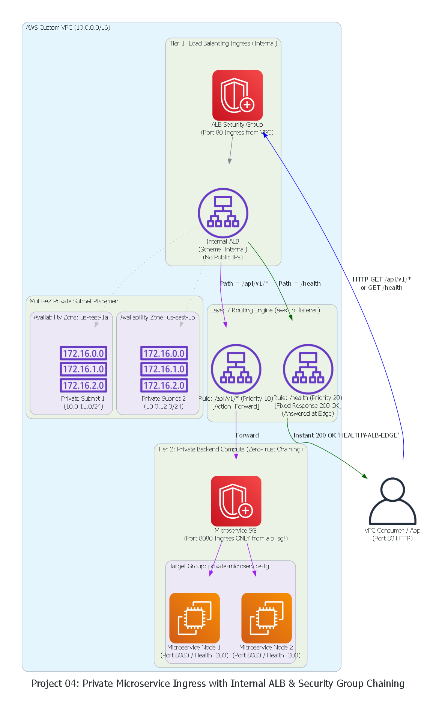

# Project 04: Private Microservice Ingress with Internal ALB & Security Group Chaining

A production-grade, multi-AZ ingress architecture engineered for **Zero-Trust internal microservices**, **Layer 7 path-based routing**, and **fine-tuned health monitoring**. Built with HashiCorp Terraform and validated against **Floci** (Local AWS Emulator).



---

## 1. Executive Summary & Production Problem Statement

In enterprise microservice architectures (Kubernetes, ECS, or EC2 fleets), backend services (e.g., payments, auth, order processing) must be protected from lateral movement and public exposure:
* **The Lateral Movement Trap:** Opening backend ports to `10.0.0.0/16` allows any compromised test container, dev machine, or bastion host in the VPC to attack backend services directly, bypassing the load balancer and any inspection layer.
* **The Health Check Flapping Disaster:** Uncalibrated health checks with aggressive timeouts create cascading fleet failures during minor CPU spikes.
* **Backend Resource Waste:** Pinging backend containers for high-frequency synthetic liveness checks wastes compute threads and memory.

This architecture solves these challenges by implementing:
1. **Security Group Chaining:** The backend microservice admits traffic **strictly from the ALB's Security Group ID**, rejecting all other traffic even from the same subnet.
2. **Internal ALB Scheme:** Strictly private IPv4 addresses provisioned across `us-east-1a` and `us-east-1b` with zero public IPs.
3. **Layer 7 Path-Based Routing:** Intelligently directing `/api/v1/*` to the target group while serving edge health checks directly at the load balancer via **Fixed Responses**.
4. **Resilient Health Checking:** Tuned thresholds ($3 \times 15\text{s} = 45\text{s}$) preventing false-positive container evictions.

---

## 2. Service-by-Service Deep-Dive (Under-the-Hood Mechanics)

### A. Custom VPC & Multi-AZ Subnets (`aws_vpc`, `aws_subnet`)
* **VPC CIDR:** `10.0.0.0/16`
* **Subnet Slicing:** Dynamic computation using `cidrsubnet(var.vpc_cidr, 8, count.index + 11)` allocates `10.0.11.0/24` (AZ-a) and `10.0.12.0/24` (AZ-b).
* **Multi-AZ ALB Requirement:** AWS enforces that Application Load Balancers must be attached to subnets in at least **2 distinct Availability Zones**. AWS provisions managed Elastic Network Interfaces (ENIs) inside each subnet to guarantee high availability in case of a zone failure.

### B. Security Group Chaining (The Zero-Trust Boundary)
* **ALB Security Group (`aws_security_group.alb`):**
  - Ingress: Port 80 (HTTP) from within the VPC CIDR (`10.0.0.0/16`).
  - Egress: Port 8080 (TCP) forwarded to VPC backend workloads.
* **Microservice Security Group (`aws_security_group.app`):**
  - **The Chaining Rule:**
    ```hcl
    ingress {
      from_port       = 8080
      to_port         = 8080
      protocol        = "tcp"
      security_groups = [aws_security_group.alb.id] # NO IP CIDRs!
    }
    ```
  - **Nitro Hypervisor Enforcement:** AWS Nitro validates the originating ENI's security group identity. Packets arriving from any source other than an ALB ENI are dropped at the network interface before reaching the operating system kernel.

### C. Internal Application Load Balancer (`aws_lb`)
* **`internal = true`:** Prevents AWS from assigning public IPv4 addresses. The ALB generates an internal DNS record resolving exclusively to private IPs inside our subnets.
* **Naming Rules:** AWS ALB names cannot begin with `"internal-"` (reserved by AWS for DNS prefixing) and must be $\le 32$ characters.

### D. Target Group & Health Monitor (`aws_lb_target_group`)
* **Target Type:** `"instance"` (or `"ip"` for direct Pod/Task IP routing in Kubernetes/ECS).
* **Health Check Parameters:**
  - `path = "/health"`: Dedicated HTTP endpoint.
  - `interval = 15s`: Spacing between probes to prevent health-check storms.
  - `timeout = 5s`: Maximum wait time before marking a probe failed.
  - `healthy_threshold = 2`: Two consecutive successes required to enter the routing rotation.
  - `unhealthy_threshold = 3`: Three consecutive failures required before evicting a target.

### E. Layer 7 Path Routing & Fixed Response (`aws_lb_listener_rule`)
* **Rule 1 (`priority = 10`):** Matches `path_pattern = ["/api/v1/*"]` and forwards traffic to the backend target group.
* **Rule 2 (`priority = 20`):** Matches `path_pattern = ["/health"]` and issues an **Edge Fixed Response**:
  ```hcl
  fixed_response {
    content_type = "text/plain"
    message_body = "HEALTHY-ALB-EDGE"
    status_code  = "200"
  }
  ```
  The ALB responds directly in $< 1\text{ms}$ from memory without touching backend compute!

---

## 3. How This Code Compares: Local Floci vs. Real-World Production

| Architectural Component | Local Floci Simulation | Real-World AWS Production | Verdict |
| :--- | :--- | :--- | :---: |
| **Terraform HCL Syntax** | 100% standard `aws_lb`, `aws_lb_target_group`, `aws_lb_listener_rule` | Identical Terraform HCL in production | **Identical** |
| **Security Group Chaining** | Enforced via local security group relationships | Hardware-enforced by AWS Nitro Hypervisor | **Identical Logic** |
| **Layer 7 Path Evaluation** | Path pattern matching (`/api/v1/*`, `/health`) | AWS Application Load Balancer proxy engine | **Identical** |
| **Edge Fixed Response** | Returns HTTP 200 `"HEALTHY-ALB-EDGE"` at edge | Returns immediate response without backend invocation | **Identical** |
| **Underlying Proxy Nodes** | Single container proxy in WSL2/Podman | Auto-scaling fleet of AWS-managed proxy instances | **Different Scale** |
| **TLS / SSL Termination** | HTTP Port 80 demonstrated locally | HTTPS Port 443 with ACM SSL Certificates in Prod | **Production Upgrade** |

---

## 4. Production Hardening: "What More Can We Do?" (Enterprise Roadmap)

For mission-critical production environments, this architecture can be upgraded with:

1. **HTTPS & AWS Certificate Manager (ACM):**
   - Attach an ACM SSL certificate to port 443 and add an HTTP $\rightarrow$ HTTPS 301 Permanent Redirect on port 80.
2. **Connection Draining (`deregistration_delay`):**
   - Configure `deregistration_delay = 30` (30 seconds) on the target group so in-flight requests finish cleanly when containers are terminated during rolling deployments.
3. **AWS WAF (Web Application Firewall):**
   - Associate an `aws_wafv2_web_acl` with the ALB to inspect HTTP bodies, block SQL injection, cross-site scripting (XSS), and rate-limit IP spikes.
4. **Mutual TLS (mTLS):**
   - Enforce client certificate validation at the ALB listener to guarantee that only authorized microservice clients possessing valid X.509 certificates can communicate with the load balancer.

---

## 5. Directory Structure

```text
04-private-microservice-ingress-alb/
├── main.tf                 # VPC, Subnets, Chained SGs, ALB, Target Group, and Layer 7 Rules
├── variables.tf            # Region, project naming, CIDR, and app port variables
├── outputs.tf              # ALB ARN, DNS name, Target Group ARN, and SG IDs
├── provider.tf             # AWS Provider configured for Floci (ec2 and elbv2 endpoints)
├── generate_diagram.py     # Automated Python Graphviz architecture generator
├── architecture_diagram.png# Generated visual architecture diagram
├── INTERVIEW_QNA.md        # 6 In-depth SRE & Cloud Architect interview scenarios
└── README.md               # Production architecture guide & verification
```

---

## 6. Step-by-Step Local Verification (Floci)

### A. Ensure Floci Services are Running
```powershell
wsl -d podman-machine-default env XDG_RUNTIME_DIR=/run/user/1000 podman start floci floci-ui
```

### B. Initialize and Apply Terraform
```powershell
cd D:\Projects\11-Programming\Terraform\04-private-microservice-ingress-alb
terraform init
terraform plan
terraform apply -auto-approve
```

### C. Verify Resources via AWS CLI
```powershell
# 1. Inspect the Load Balancer (Verify Scheme: internal)
aws --endpoint-url=http://localhost:4566 elbv2 describe-load-balancers

# 2. Inspect Target Group & Health Check parameters
aws --endpoint-url=http://localhost:4566 elbv2 describe-target-groups

# 3. Inspect Layer 7 Listener Rules (/api/v1/* and /health)
aws --endpoint-url=http://localhost:4566 elbv2 describe-rules --listener-arn "<YOUR_LISTENER_ARN>"

# 4. Inspect Chained Security Groups
aws --endpoint-url=http://localhost:4566 ec2 describe-security-groups --group-names "private-microservice-alb-sg" "private-microservice-app-sg"
```

### D. Inspect via Floci Web UI
Open your browser to:
* **Floci Dashboard:** `http://localhost:4500`
* Navigate to **EC2 / Load Balancers** to inspect `private-microservice-alb`, its listener rules, and target groups.

### E. Clean Up
```powershell
terraform destroy -auto-approve
```

---

## 7. SRE & Cloud Architect Interview Mastery Guide

For deep-dive scenarios covering Nitro Security Group Chaining, Layer 4 vs Layer 7 trade-offs, health check death spiral prevention, and stateful vs stateless connection tracking, read:
👉 **[INTERVIEW_QNA.md](./INTERVIEW_QNA.md)**
